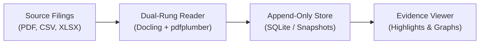
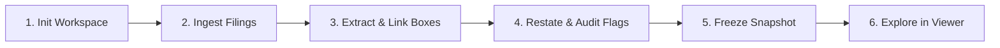

<p align="center">
  
</p>

<h1 align="center">GoCarbonTracker (gct)</h1>

<p align="center">
  <strong>An open-source workspace and evidence engine for corporate climate disclosures, tracing claims to document pages with an append-only audit trail.</strong>
</p>

<p align="center">
  <a href="LICENSE"></a>
  <a href="https://www.python.org/downloads/">= 3.11" /></a>
  
  
  
  <a href="https://gocarbontracker.net/paper"></a>
  <a href="https://gocarbontracker.net/paper.pdf"></a>
</p>

<p align="center">
  <a href="https://gocarbontracker.net">Website</a> •
  <a href="https://gocarbontracker.net/paper">Research Paper</a> •
  <a href="https://gocarbontracker.net/paper.pdf">PDF</a> •
  <a href="https://hypergraph.gocarbontracker.net">Interactive Hypergraph</a> •
  <a href="https://dashboard.gocarbontracker.net">Dashboard</a>
</p>

---

## Status

This is experimental software. Do not rely on it to keep private material out of what you share.

- The privacy acceptance of the sharing features (Epic 7) FAILED, and the release's final acceptance is INCOMPLETE.
- A sanitised output or a package is designed to leave private content out, but it is not verified to be free of it. These are the known ways a credential (such as an API key or a token) can still get through:
  - A credential in a PDF annotation, such as a note box, can appear in an evidence image and in the copy of the original that a package holds.
  - A credential in a PDF's metadata, such as its title, reaches the copy of the original in a package.
  - A package copies CSV and XLSX originals without checking them for credentials, so a credential in a cell ships.
  - A credential written in fullwidth characters is removed from every report format, but it ships in the database files inside a package.
- The leakage check that was run on exports made from real data left 15 images unread, so that check has not passed.
- None of these is fixed in this version. Read any sanitised output or package before you share it. [docs/privacy.md](docs/privacy.md) records the limits of the credential check under "What never leaves".

---

## Setup

Needs Python 3.11 or newer. [docs/setup.md](docs/setup.md) is the whole guide: Windows (not tested), an offline install, the first run and moving a workspace to another computer. The commands below are for macOS. `python3` must be 3.11 or newer (check with `python3 --version`). Python 3.13 on Apple Silicon macOS is the only combination that has been run; 3.11 and 3.12 are allowed by the package and have not been run.

User form (a copy of gct in its own environment, from the code folder):

```bash
python3 -m venv .venv
source .venv/bin/activate
pip install .
gct --version
```

Contributor form (linked to the code folder, with the tests):

```bash
python3 -m venv .venv
source .venv/bin/activate
pip install -e '.[dev]' 'setuptools>=77'
pytest
```

---

## Overview

Corporate sustainability reporting suffers from an **assurance deficit**:
* **Questionnaires fail to verify**: Scope 3 decarbonization programs rely heavily on questionnaires where suppliers check boxes without attaching verifiable proof.
* **Manual reading does not scale**: Analysts spend weeks combing through 150-page sustainability reports (PDF, BRSR, CSRD, GRI tables) to copy-paste numbers into spreadsheets. Transcription errors occur, and citation context is lost.
* **Restatements disappear**: Companies regularly adjust historical baseline figures in subsequent disclosures without drawing attention to the changes.

**GoCarbonTracker (`gct`)** is a local-first workspace and evidence engine. It ingests corporate sustainability filings, extracts quantitative climate metrics (Scope 1, Scope 2, Scope 3 categories, energy usage, targets), and **anchors every single claim directly to its exact page coordinate and bounding box on the original document**, backed by an append-only audit trail.

---

## Who is It For?

| Role | Operational Problem | How GoCarbonTracker Solves It |
| :--- | :--- | :--- |
| **Scope 3 & Procurement Leads** | Cannot meter suppliers' factories; questionnaire response rates are low and unverified. | Ingests suppliers' published reports; provides a queryable portfolio with page-level citations for every Scope 1, 2, and 3 metric. |
| **Sustainability Auditors** | Demands checkable evidence, not opaque AI summaries or unverified spreadsheets. | Provides an interactive click-to-highlight viewer that navigates straight to the source table cell or paragraph. |
| **Corporate Reporting Teams** | Prepares CSRD/SEC/BRSR filings; needs to track multi-year baseline restatements and review history. | Automatically surfaces restatements across annual disclosure cycles with immutable change logs. |

---

## System Architecture

GoCarbonTracker is built as a **local-first, deterministic evidence pipeline**. It runs entirely on your local machine with zero external network dependencies required during core operations.



---

## Practitioner Workflow



---

## Installation

### Prerequisites
* **Python**: `>= 3.11` (Tested and benchmarked on Python 3.13 macOS Apple Silicon). Check with `python3 --version`.

### Option A: Standard User Installation
Installs `gct` into an isolated virtual environment:

```bash
# Clone the repository
git clone https://github.com/GoCarbonTracker/go-carbon-tracker.git
cd go-carbon-tracker

# Create and activate virtual environment
python3 -m venv .venv
source .venv/bin/activate

# Install package
pip install .

# Verify installation
gct --version
```

### Option B: Contributor & Developer Installation (with Test Suite)
Installs editable development dependencies, test harness, and build tools:

```bash
cd go-carbon-tracker
python3 -m venv .venv
source .venv/bin/activate

# Install editable with dev dependencies
pip install -e '.[dev]' 'setuptools>=77'

# Run the automated test suite
pytest
```

---

## Quickstart Tutorial

Follow this 5-minute walkthrough to initialize a workspace, ingest a disclosure, and explore the interactive evidence viewer.

### 1. Initialize a Workspace
```bash
gct workspace init company-audit
```
*Creates the workspace directory structure: SQLite database, file store, layout artifacts, published snapshots, and run logs.*

### 2. Register an Organisation
```bash
gct company add "Acme Global" --workspace company-audit
```

### 3. Add Corporate Disclosures
```bash
# Add reports (or use the included sample: examples/sample_sustainability_report.pdf)
gct doc add examples/sample_sustainability_report.pdf --company "Acme Global" --workspace company-audit
```
*The file is hashed with SHA-256. If duplicate bytes are uploaded under a different name, `gct` rejects the duplicate and references the original.*

### 4. Read Layout & Extract Claims
```bash
# 1. Deterministic text, table, and deep layout parsing (pdfplumber + Docling)
gct read --workspace company-audit

# 2. Extract quantitative emissions metrics and qualitative climate commitments (Rung 1 & 2)
gct extract --workspace company-audit

# 3. Anchor claims to physical bounding boxes on the document page
gct link --workspace company-audit

# 4. Infer reporting periods and organizational boundaries
gct infer --workspace company-audit

# 5. Harmonize claims and match cross-report time series
gct match --workspace company-audit
```

### 5. Audit Restatements & Propose Greenwashing Candidates
```bash
# Detect multi-year restatements and baseline discrepancies
gct restate --workspace company-audit

# Scan narrative & quantitative claims against evidence with EmeraldMind 4-type taxonomy (Auditor Copilot)
gct flag propose --company "Acme Global" --workspace company-audit

# Inspect proposed greenwashing candidate flags
gct flag list --workspace company-audit
```
*Note: Under FR39 responsible governance, candidate flags are proposals for human auditor review and must be confirmed (`gct flag raise`) by an auditor before becoming part of an official published record.*

### 6. Freeze Published Version Snapshot
```bash
gct publish build --workspace company-audit
```
*Freezes read-only data version `v1.db`. Any subsequent audit annotations or revisions generate `v2.db`.*

### 7. Launch the Local Interactive Evidence Viewer
```bash
gct serve --workspace company-audit
```
*Starts a secured local service and opens your default browser at `http://127.0.0.1:8765/?token=...`.*

* **Interactive Side-by-Side View**: Browse the claims table on the left; click any figure to jump directly to the PDF page on the right with the number highlighted in yellow.
* **Dual-Track Review**: Add company self-declarations, record auditor verifications, or flag restatements.
* **Explore Visual Graphs**: Open the **Graphs** tab to explore claims mapped across **Neighbourhood**, **Hypergraph**, and **Time-Series** views.

---

## What works today

- `gct workspace init PATH` creates a workspace folder (SQLite database plus `files/`, `artifacts/`, `published/`, `exports/`, `logs/`).
- `gct company add NAME` and `gct company list`.
- `gct doc add SOURCE... --company NAME` registers PDF, XLSX and CSV files (recognised from content) for that one company. Each SOURCE is a file, a folder (its direct children of those types, by name) or a direct `http://` or `https://` link. The original is stored once by SHA-256. Adding the same bytes again is reported as a duplicate. Adding a changed file under the same name creates a new version and keeps the old one. A batch keeps going past a bad item, reports each one, and exits 4 if any was refused or failed. A link is downloaded once (only the address is sent); adding it again reuses that download. `--plan` shows what would happen to each item and stores nothing. A batch leaves one run record. Each document gets a privacy label and an availability; see "Privacy labels" below.
- `gct doc list` and `gct doc show ID`, each with the document's label and availability.
- Documents default to the `private` label (see [Status](#status)).
- `gct publish build` writes the next numbered, read-only data version (`published/vN.db`, companies and active documents) and makes it current. `gct publish restore` makes the previous version current again without rebuilding. `gct publish status` shows the current version and whether new history has arrived since. Only the current and previous files are kept; history is never touched.
- `gct publish build` and `gct publish restore` each leave a run record. `gct run list` shows the runs, newest first, with their outcome (`ok`, `failed`, or `interrupted` when the process stopped before finishing). `gct run show ID` shows one run: methods used, failures, retries, estimated and confirmed cost on separate lines, outputs, and every event.
- `gct workspace status` shows the schema version, the gct version, the number of companies and documents, the current published version, the number of runs and how the latest one ended.
- A workspace made by an older gct is upgraded automatically the first time a newer gct opens it, and the upgrade is recorded as a run. A workspace made by a newer gct is refused. See `docs/migrations.md`.
- `gct serve` starts a local service and opens it in your browser. It prints an address with a one-time session key (`http://127.0.0.1:8765/?token=...`); only that address lets a browser in, and the service listens on this computer only, with no setting to change that. `--port N` picks another port, `--no-open` skips the browser. It shows the evidence viewer for the current published version: pick a document, click a figure in the claim list to jump to its page with the figure boxed, or click a box to select its figure. Left and right arrows change the page, up and down move through the claims. Each figure shows its source-match label (`matched`, `cited` or `unresolved` with the reason, or `not checked: run gct link`). Each figure also shows its published period and boundary with their state (see Periods and boundaries); a version published by an older gct asks you to run `gct publish build` first. The panel also shows the claim's state, a correction with who made it, why and the value it replaced, anything that needs re-review, and a boundary header printed above the figure's column. The viewer can correct a current figure (see Corrections and re-reading). Under each figure, its Reviews section shows the company confirmations and auditor reviews of a version (the newest by default, earlier versions in a picker) in two columns, with a band when the two disagree, then its highlights and reviewer flags, and forms to add a company confirmation, an auditor review, a highlight, or to raise or withdraw a reviewer flag. Each company's Candidates entry lists its inconsistency candidates; one opens both pages with the two figures boxed and a form to adjudicate it (a restatement stays the `gct restate record` command, shown to copy). Every change runs the same check as its CLI command, waits for no other command (refused while one holds the workspace) and publishes a new version. A change is only accepted from the viewer page itself or with the session key sent as `Authorization: Bearer`.
- A stage contract and result cache exist for the processing stages, so an unchanged result is reused, only failed items are retried and a result from an older input or setting is never served. Downloading a link is the first stage that runs through it.
- `gct read [ID ...] [--company NAME]` reads every page of PDF documents with pdfplumber: text, words with their positions, and ruled tables. Without IDs it reads every active document. Each reading is a JSON file under `artifacts/`, stored once by SHA-256. A page already read with the same file and the same reader settings is never read again; a changed setting reads it again. Each page gets three checks: no text (a scanned picture), fragmented text, and tables that are mostly empty cells. Flagged pages are counted and the number of pages without text is always printed. Nothing is sent anywhere and no model is used. A damaged PDF or a page that fails is reported, the rest is read, and the command exits 4; running it again reads only what is missing.
- `gct doc pages ID` shows, per page, how it was read: rung, method, words, tables and quality flags.
- Paid model work and sending private content to an outside service each need their own approval, and both are off by default. `gct approve spend AMOUNT` sets the workspace's estimated spending limit in USD (0 means no paid work); each paid run will also need its own allowance, which must fit under the limit minus the estimated spend so far. The limit is estimated from the configured prices and the usage the provider reports, not taken from a provider bill. `gct approve transfer NAME` lets one external model service receive private documents, `--revoke` withdraws it. The approval holds only for the address and model the adapter had when it was given; change either in the file and it must be given again. `gct approve list` shows the limit, the estimated spend so far and the approval of each adapter. A call that would pass the allowance or the cap, or send a private document without a transfer approval, is refused and never sent. Spend counts the cost the provider reported when it reports one, and otherwise gct's own figure: the token counts the provider returned times the configured prices, or the estimate made before the call. Calls that failed after they were sent count too. Only a cost the provider returned is shown as confirmed.
- Model adapters are described in a file of their own, `~/.config/gct/models.toml` (or the path in `GCT_MODELS`), never in the workspace. Each `[adapters.NAME]` table gives `provider = "openai_chat"` (the chat completions interface of Ollama, NVIDIA, OpenRouter and OpenAI), `base_url`, `model`, `external`, `paid`, and optionally `api_key_env` (the name of the environment variable holding the key, never the key itself), `price_in` and `price_out` (USD per million tokens) and `timeout`. An adapter marked `external = false` must point at this computer. Prices and the timeout must be numbers of 0 or more. A model service that answers with a redirect gets a failure; gct never follows it. `gct model list` shows the adapters and whether each key variable is set. Keys and anything that looks like one are replaced by `[redacted]` in error logs, the run log, failure messages and text sent to a model. Without the file nothing changes: rung 1 reading needs no model. Configured is not enabled: no reading step uses a configured model in this version, so an adapter changes nothing about `gct read` or `gct extract` (see [docs/models.md](docs/models.md)).
- `--json` on every command. Key names are in `docs/cli-json.md`.
- Every table except `schema_version` rejects updates and deletes.
- Only one command that changes a workspace runs at a time: a second one is refused (exit 4) until the first finishes. Commands that only look (`list`, `show`, `status`, `doc pages`, `run list`, `run show`, `serve`) are not held up (apart from a one-time workspace upgrade), so you can watch a long run. The lock is the operating system's, on `workspace.lock`; it goes away with the process, also after a crash.
- A failed command prints one cause and one next step, also for a mistyped option (exit codes and the run log in `docs/troubleshooting.md`). `gct --version` prints the version. `gct troubleshoot export` writes `exports/troubleshooting-<time>/` with the versions, counts and run history a maintainer needs to help, and no document, company or contributor name, path or key; read it before you send it.

---

## Claims

Claims from `gct extract` come from fixed reading rules (a no-model baseline). Their accuracy was measured once, against a private gold set of 170 figures from the reports of two real companies (scorer version 1, gold commit 3985743). The gold set has three groups; the result was 0 of 80 Found in the text group, 0 of 50 in the table group and 0 of 40 in the figure group. Found means value, unit, metric, entity, boundary and period all match the gold row. The release plan's accuracy gate (G2) sets a target of 90% Found in each group, so the no-model baseline fails it. The gold set is private and is not in this repository.

- `gct extract [ID ...] [--company NAME]` lists the figures on every read page: numbers in ruled tables, and numbers followed by a unit (`tCO2e`, `MWh`, `%` and a few more) in the text. Each claim keeps the metric wording, the value, the unit and the period label exactly as printed, plus the page and the box it came from. A value is filled only for a plain Western number (`1,234.5`); other forms such as `1,23,456` or `(12)` keep only the printed text. Years and numbers in the top or bottom 5% of the page are not claims. Units are recognised, never converted; the extracted boundary is `unknown` (see Periods and boundaries). A table figure's box comes from the cell pdfplumber found; when the cell's words do not match the figure, the claim gets no box (its source match is `cited`, reason `no box`), never a guessed one. A page whose reading has not changed is not extracted again; a new reading adds a new version of each claim and keeps the old one. Documents not read yet are skipped with a note.
- `gct claims list --doc ID` shows one line per claim: claim id, page, value as printed, unit, metric wording, the period (the label as printed until `gct infer` runs, then the dates with a state word, or the label and `unknown` with the reason), the boundary in the same way, the source match status with its reason, and the box when there is one.
- `gct publish build` includes the newest version of each claim of active documents, with its source location and source match status.

---

## Packages

A package is a copy of the workspace for someone else to reopen, add reports to and process again. gct writes it fresh into `exports/package-v<N>-<stamp>-<mode>/`, with its own data version 1.

- `gct package preview [--complete] [--include identity,contributor_text,flags]` shows what would go in and what is left out, and prints a token. It writes nothing.
- `gct package create --confirm TOKEN [--include ...]` writes a package that is designed to leave private content out (see [Status](#status)): only rows of shareable documents, contributors shown as "Contributor 1", "Contributor 2" and so on, their text withheld, no run log lines, approvals or saved views. Each `--include` class keeps its own part.
- `gct package create --complete --include-private --confirm TOKEN` writes everything except approvals, private documents included; the source run log records that you authorised it.

Both refuse a data version that is out of date (build a fresh one with `gct publish build`) and a token from another preview. A copy of the workspace folder is a complete copy of everything in it. Details are in `docs/packages.md`.

---

## Report preview

`gct report preview [--filter JSON|@FILE] [--complete] [--include identity,contributor_text,flags] [--data-version V]` shows what a report of the current published version would hold: the version it reads, the rows per report and, for a sanitised output (the default), what it leaves out and why. A sanitised output is designed to leave out every row that names a private document, archived and deleted documents, reviewer flags, contributor text and contributor names (each contributor becomes "Contributor N"), within the limits under [Status](#status); `--include` keeps the named classes. Values such as the review summary are worked out again from the rows that stay, so they read as if the left-out rows did not exist. `--complete` keeps every row, each with its label. When every document in the selection is private, the preview names them and gives the `gct doc label` command. The preview writes nothing, and it refuses a workspace that needs an upgrade until a writing command such as `gct publish build` has upgraded it. Details are in `docs/privacy.md`.

---

## Exporting report data

`gct report all --format json` writes the report data of the current published version into a new folder, `exports/all-v<N>-<stamp>-sanitised/`: `dataset.json`, which holds the evidence index, the restatement log and the gap report with the data version it came from, and `dataset-1.schema.json`, the JSON Schema the file follows, so anyone can check the file without GCT. `evidence-index`, `restatement-log` and `gap-report` work the same way; a JSON export holds the whole dataset whichever you name. The options are those of `gct report preview`: the export is sanitised unless you add `--complete`, and a complete folder ends in `-complete`. The command prints the preview after the files, on your terminal only. It never overwrites an export, and a refused export writes nothing. When the workspace has changed since the version was built, it still exports that version and tells you to run `gct publish build` first if you want the changes. Copies you have exported or shared cannot be recalled by GCT, also after `gct doc delete`. Details are in `docs/reports.md`.

- `--format pdf` writes one PDF per report, for a reader who does not run GCT: the rows, then an evidence appendix that shows each cited figure as a picture of its place on the source page, cut from the stored original with the viewer's renderer and outlined; a sanitised PDF is designed to hold no private text or page image (see [Status](#status)).
- `--format page` writes one HTML page per report with the same rows and pictures, which opens from the export folder in a browser and runs no script and loads nothing from the network.

---

## What does not exist yet

OCR for scanned pages, model-based rungs (no rung above 1 exists yet, so nothing calls a model and no command takes an allowance yet), chart reading, standard metric names, review in the viewer of page acceptance, gap confirmation, infer review and restatement (those stay CLI commands). `docs/setup.md` says what the no-model install reads and does not read.

---

## Core Capabilities & Features

### 1. Zero-Model & Deep Layout Reading (Rung 1 & Rung 2)
* **Tiered Reading Architecture**: Operates locally with a dual-rung reading pipeline.
  * **Rung 1 (Fast Deterministic)**: Uses `pdfplumber` for ruled tables, standard typography, and Indian numeric grouping with zero token spend.
  * **Rung 2 (Deep Layout & Reading Order)**: Integrates IBM `Docling` (`docling>=2.54.0`) to parse complex corporate report layouts, multi-column reading orders, borderless tables, and rotated headers into structured markup.
* **Automatic Fallback**: If Docling is not installed or encounters an unsupported structure, `gct` seamlessly falls back to Rung 1 without failing execution.
* **Environment Control**: Activate Docling across reading runs via `GCT_USE_DOCLING=1` or run document-specific escalation (`gct read <DOC_IDS...>`).
* **Page Quality Auditing**: Automatically identifies scanned bitmap pages (0 extractable text characters), fragmented text runs, or empty table matrices.

### 2. Physical Evidence Anchoring
Every claim stores coordinates in standard PDF points (`[x0, y0, x1, y1]`). Claims receive an unambiguous status:
* `matched`: Exact character and bounding box match within a detected table cell or text span.
* `cited`: Referenced in text or footnote without a discrete rectangular cell box.
* `unresolved`: Unanchored claim flagged for analyst inspection.

### 3. Multi-Year Harmonization & Restatement Engine
* Tracks metrics across multiple reporting cycles.
* Automatically surfaces historical restatements (e.g. when an organization revises its FY21 baseline in its FY24 annual filing).
* Stores explanatory footnotes and captures contributor rationales.

### 4. Automated Time-Series & Cross-Company Comparison
* Automated matching groups figures by company, canonical metric key, reporting boundary, and unit family. Besides emissions, energy, water and waste, it links headcount, board, safety, spend and financial totals: counts as counts, and each currency on its own with no exchange rate (see `docs/matching.md`).
* Proposed periods (including Indian fiscal years ending March 31) and default boundary scopes project directly into queryable time series.
* Supports dual-track Scope 2 emissions reporting (`ghg_scope_2_location` and `ghg_scope_2_market`).

### 5. Double-Track Audit Ledgers
* Maintains independent ledgers: **Company Self-Declarations** vs. **Third-Party Auditor Reviews**.
* Neither track can overwrite the other. Divergences render an active visual disagreement band in the viewer.
* The underlying SQLite database prohibits SQL `UPDATE` and `DELETE` queries on audit history. Corrections are recorded as appended revisions.

### 6. Multi-View Graph Explorer (Cytoscape)
* **Neighbourhood Graph**: Visualizes a claim node linked to its source page, period, reporting boundary, and review state.
* **Hypergraph**: Models claims as hyperedges connected to shared hub members (e.g., shared document pages or organizational perimeters).
* **Time-Series Matrix**: Aligns multi-year figures across reporting cycles, making baseline shifts immediately obvious.

### 7. Audit-Ready Export Packages
* **JSON Schema Export**: `gct report all --format json` produces canonical machine-readable datasets validated against a public schema.
* **PDF with Evidence Crops**: `gct report all --format pdf` generates executive reports containing 150 DPI page crops of the exact source evidence.
* **Air-Gapped Privacy**: Sensitive documents default to `private`. Sanitized export packages strip out user identities, private files, and internal notes.

### 8. Auditor Greenwashing Copilot & EmeraldMind Taxonomy
To address the assurance deficit without unfair automated allegations, `gct flag propose` scans extracted narrative claims and quantitative targets against source document context using the **EmeraldMind 4-Type Taxonomy**:

* **Type 1 (Factually False / Unaccredited Labels)**: Unverified certifications, unaccredited green labels, or misrepresented ESG compliance standards.
* **Type 2 (Legal Mandates Framed as Voluntary)**: Framing mandatory statutory obligations (e.g. CSRD, EU ETS compliance) as voluntary corporate climate leadership.
* **Type 3 (Boundary Mismatch / Scope Overgeneralization)**: Claims asserting whole-company or fleet-wide decarbonization (e.g. "100% zero emissions operations") when supporting evidence reveals it applies only to HQ buildings, a pilot facility, or excludes core subsidiaries.
* **Type 4 (Direct Factual Contradiction)**: Narrative claims stating progress or emission reductions that are directly contradicted by numbers reported in the disclosure tables (e.g., claiming "reduced carbon footprint" alongside an increase in Scope 1 emissions).
* **Strict Responsible Abstention**: Missing evidence, vague marketing language, or high ambition without contradictory proof strictly triggers an **Abstain** verdict. Tone-based accusations are strictly forbidden.

#### Interactive Web UI Implementation:
* **One-Click Flagging**: Select any claim in the evidence viewer and click **"Flag a potential greenwashing concern"** in the sidebar to record your rationale and audit capacity.
* **Side-by-Side Proof**: Clicking any flagged or candidate claim immediately jumps the PDF viewer to the exact page with physical bounding-box highlighting, allowing instant side-by-side verification of narrative claims against reported table figures.
* **Filter Bar**: Filter the claims table by review status, including `flag-raised` to review all flagged claims in a portfolio.
* **Cytoscape Graph Explorer**: Flags render as linked triangular review nodes in both the **Neighbourhood** and **Hypergraph** views.
* **FR39 Human-in-the-Loop Governance**: Automated scanning proposes unreviewed candidates. Only an auditor or practitioner can confirm (`gct flag raise` or web UI form) and commit a flag to the permanent audit trail.

---

## CLI Command Summary

| Command Group | Command Syntax | Description |
| :--- | :--- | :--- |
| **Workspace** | `gct workspace init <PATH>` | Initialize a clean workspace directory and database. |
| | `gct workspace status` | Check schema version, document counts, and latest run status. |
| **Organisations** | `gct company add <NAME>` | Register an entity or supplier. |
| | `gct company list` | List registered entities. |
| **Documents** | `gct doc add <SOURCE...>` | Ingest PDF, CSV, or XLSX files (files, folders, or URLs). |
| | `gct doc list` | List active documents with SHA-256 hashes and quality flags. |
| | `gct doc delete <ID>` | Archive or permanently delete a document and purge derived data. |
| **Extraction** | `gct read` | Extract words, reading order, and tables locally via `pdfplumber` and `Docling`. |
| | `gct extract` | Extract quantitative emissions and qualitative climate commitments (Rung 1 & 2). |
| | `gct link` | Map extracted claims to physical bounding boxes on document pages. |
| | `gct infer` | Propose and resolve reporting periods and organizational boundaries. |
| | `gct match` | Harmonize claims into canonical metric keys and cross-report series. |
| **Restatement** | `gct restate` | Detect pairs of figures across reports: same value, restatement or conflict. |
| **Auditing & Flags** | `gct flag propose [--company NAME]` | Scan narrative and quantitative claims against evidence and propose greenwashing candidates. |
| | `gct flag raise <CLAIM_ID> --version <V> --rationale <TEXT>` | Confirm and raise an auditor concern on a claim version. |
| | `gct flag withdraw <CLAIM_ID> --version <V>` | Withdraw an auditor flag on a claim version. |
| | `gct flag list` | List all reviewer and proposed flags, oldest first. |
| **Versioning** | `gct publish build` | Freeze current state into an immutable published snapshot (`vN.db`). |
| | `gct publish restore` | Roll back to the previous published snapshot. |
| **Viewer** | `gct serve [--port N]` | Launch the local authenticated web viewer. |
| **Reports** | `gct report all --format [json\|pdf\|page]` | Export evidence indexes, restatement logs, and gap reports. |
| **Packages** | `gct package create --confirm <TOKEN>` | Create a sanitized or complete workspace bundle for counterparties. |
| **Auditing** | `gct run list` / `gct run show <ID>` | Inspect execution history, retries, errors, and run parameters. |

---

## Milestone 2 Roadmap: HyperGraphRAG & Evidence Retrieval

Milestone 2 (M2) expands GoCarbonTracker from single-document extraction into an evidence-linked retrieval and multi-company intelligence engine:

* **Evidence-Linked HyperGraphRAG**: Natural language search and Q&A across multi-year corporate filings. Queries are strictly constrained by reporting period, organizational boundary, and metric definitions. Every answer cites exact source coordinates ($[x_0, y_0, x_1, y_1]$); if evidence is missing, GCT reports "insufficient evidence" rather than guessing.
* **Pluggable Jev Reranking (`jev-1.13.0`)**: Two-stage retrieval pairing local high-recall candidate extraction (BM25 + hypergraph index) with TypeSafe Jev for high-precision passage reranking and contradiction adjudication across conflicting claims.
* **Scope 3 Category 1 Supplier Networks**: Multi-company workspace portfolios mapping supplier-buyer disclosures, automated spreadsheet ingestion, and independent buyer-side reviews vs. supplier confirmations.

---

## Theoretical Foundations & Framework Alignment

### Research Foundations
* **Claims as Hyperedges (HyperGraphRAG)** ([Paper](https://gocarbontracker.net/paper) · [PDF](https://gocarbontracker.net/paper.pdf)): *Claims as Hyperedges: Auditable Multi-Hop Retrieval and Discourse Reasoning over Enterprise Disclosures* (Varun Moka, 2026) — Formalizes the 5-pillar architecture combining hypergraph structural modeling, discourse claim-evidence graphs, multi-signal hybrid retrieval, cross-document contradiction detection, and deterministic bounding-box provenance.
* **Discourse Knowledge Graphs** ([Chan et al.](https://arxiv.org/abs/2105.00843)): Adapts discourse schemas to represent climate disclosures as structured networks of **Questions**, **Claims**, **Evidence**, and dialectical relations (*corroborates*, *restates*, *contradicts*).
* **Hypergraph Knowledge Networks** ([Gao et al.](https://arxiv.org/abs/2003.01853), [Sun et al.](https://arxiv.org/abs/2401.05489)): Represents disclosures as high-order hyperedges that simultaneously connect claims across document pages, reporting perimeters, multi-year time series, and supply-chain counterparties.

### Supported ESG Frameworks & Standards
* **CSRD / ESRS (E1 Climate Change)**: Scope 1, Scope 2 (market/location-based), Scope 3 Categories 1–15, baseline recalculation disclosures, and carbon targets.
* **GHG Protocol**: Corporate Accounting & Reporting Standard and Corporate Value Chain (Scope 3) Standard.
* **BRSR (SEBI India)**: Principle 6 Essential Environmental Indicators for listed corporate enterprises.
* **SEC Climate Rules & ISSB / IFRS S2**: Boundary consolidation rules, double-track assurance records, and multi-year restatement tracking.

---

## Documentation Index

Comprehensive documentation is available in the [`docs/`](docs/) directory:

* [**Architecture & Framework**](docs/framework.md) — The GCT climate assurance model, boundary rules, and double-track ledger.
* [**Extraction Methodology**](docs/methodology.md) — Rung-1 deterministic layout analysis, bounding box extraction, and restatement algorithms.
* [**Setup & Installation Guide**](docs/setup.md) — Offline installation, platform-specific notes, and cross-machine workspace transfer.
* [**Views & Visualization**](docs/views.md) — Details on the Tables and Graphs tabs, Cytoscape layouts, and saved views.
* [**Reporting & Exporting**](docs/reports.md) — Generating JSON Schema datasets, CSVs, and PDF evidence appendixes.
* [**Privacy & Data Governance**](docs/privacy.md) — Privacy labels, air-gapping, sanitization preview, and export limits.
* [**Troubleshooting & Run Logs**](docs/troubleshooting.md) — Error codes, recovery procedures, and generating diagnostic packages.

---

## Status & Operational Notice

This is **`v0.2.1-alpha` (Story M1 Feature Release)** experimental software. Please note the following verified acceptance boundaries:
* **Metric list v3 (M1-4.6)**: 43 canonical metric keys with count and currency unit families, so headcount, board, safety, spend and financial totals form series next to emissions, energy, water and waste (`docs/matching.md`). Workspaces upgrade through migration 0023.
* **Docling Reading Layer**: Deep layout and reading order recovery integrated into `gct read` (Rung 2) alongside deterministic `pdfplumber` (Rung 1).
* **G2 Scorer v2 Ruler**: Frozen gold benchmark evaluation measuring machine-inferred and human-adjudicated claims with bounding box IoU >= 0.50.
* **Multi-line Figure Header Stacking**: Automated vertical grouping for category and metric titles in figure stat cards.
* **Boundary Precision & Segment Matching**: Standalone listed-entity scoping and maximal substring conflict resolution across corporate disclosure boundaries.
* **Auditor Greenwashing Copilot**: Scans narrative and quantitative claims against report evidence using the EmeraldMind 4-type taxonomy (`gct flag propose`) with strict responsible abstention. Automated candidates are surfaced with visual bounding boxes for human auditor review; GCT never assigns public greenwashing flags autonomously (FR39).
* **Rung 1 & Rung 2 Extraction**: Extraction combines rule-based parsing (`pdfplumber`, `Docling`) for structured numeric figures with local semantic filtering (`climatebert/environmental-claims` on Apple Silicon MPS / CUDA / CPU) for qualitative environmental commitments. Optional model dependencies are installed via `pip install "gct[models]"`.
* **Privacy Limits in Sharing Features**: While sanitized packages exclude private documents and contributor names by default, note that PDF metadata, annotations, or fullwidth characters in database files are subject to limits documented in [docs/privacy.md](docs/privacy.md). Always review packages prior to sharing.

---

## Citation

If you use GoCarbonTracker or the HyperGraphRAG architecture in your research or audit workflows, please cite our paper ([Read Online](https://gocarbontracker.net/paper) · [Download PDF](https://gocarbontracker.net/paper.pdf)):

```bibtex
@article{moka2026hypergraphrag,
  title   = {Claims as Hyperedges: Auditable Multi-Hop Retrieval and Discourse Reasoning over Enterprise Disclosures},
  author  = {Moka, Varun},
  year    = {2026},
  journal = {GoCarbonTracker Research Preprint (arXiv v5.0)},
  url     = {https://gocarbontracker.net/paper},
  note    = {PDF available at https://gocarbontracker.net/paper.pdf}
}
```

---

## License & Provenance

* Licensed under the [MIT License](LICENSE).
* See [ORIGINS.md](ORIGINS.md) for detailed patent, provenance, and dependency attribution notices.
